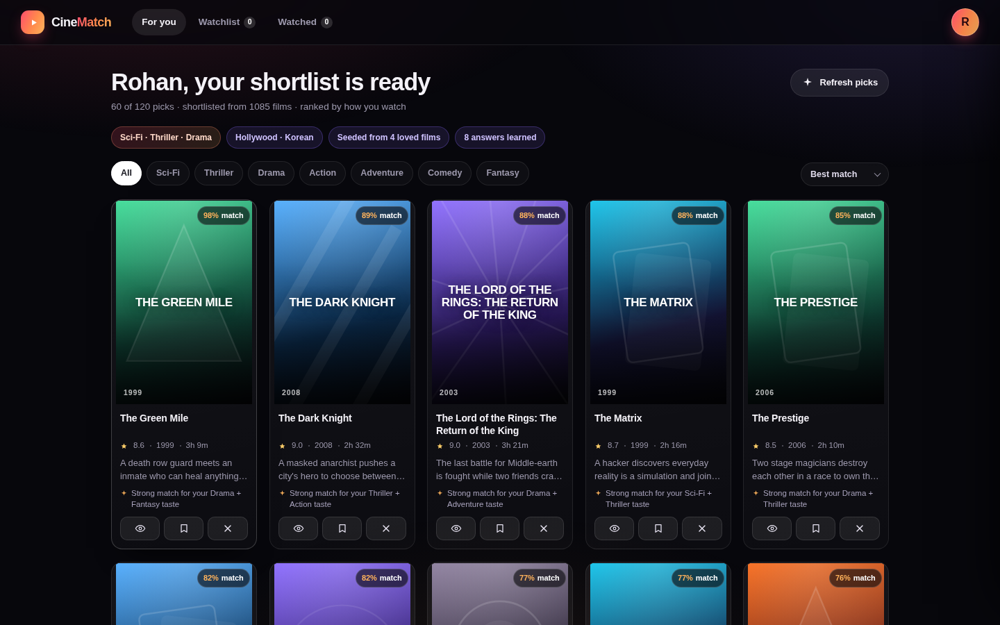
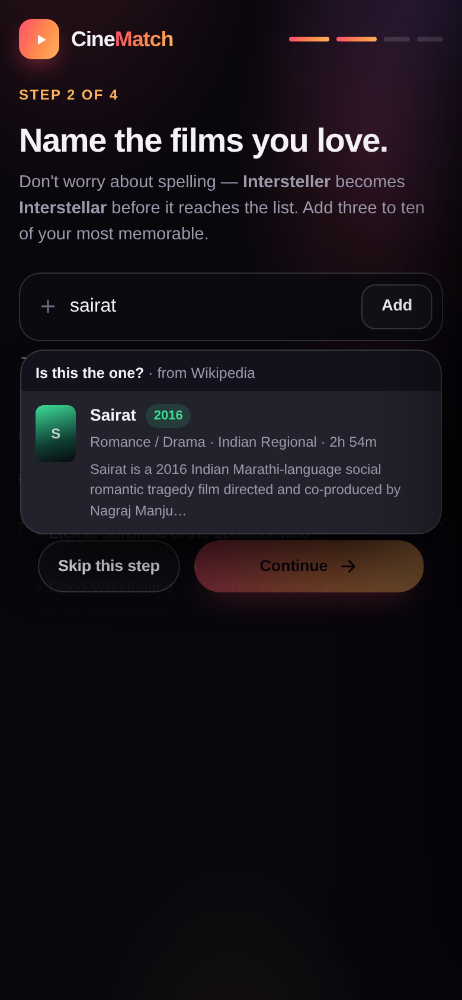

# CineMatch 🎬

A taste-first movie recommendation site. No endless scrolling through posters — you tell CineMatch
what you already love, it asks a few sharp questions, and it hands you a ranked shortlist of 60+ films
that keeps learning from every "watched / watch later / not for me" tap.

Works as a single responsive app on laptops, tablets and phones (tested from 320 px up to 1440 px+).



*Films that aren't in the catalogue are looked up on Wikipedia/Wikidata and added only after you confirm:*



---

## The flow

1. **Sign up** — name (email optional). No password, no third party auth.
2. **Genres** — pick genres plus languages/industries. Each selection seeds the taste profile.
3. **Films you love** — type titles into one box. Spelling does not matter:
   `incepton → Inception`, `shawshenk → The Shawshank Redemption`, `parasyte → Parasite`,
   `dune 2 → Dune: Part Two`. Live suggestions, keyboard navigation, and comma-separated paste are all supported.
4. **Confirm** — the resolved list is shown with a badge per row (`exact match` / `spelling corrected` /
   `close match`), and anything that isn't in the catalogue is listed separately. Remove what doesn't feel like you, then confirm.
5. **"Would you watch this?"** — 8 adaptive probe cards (poster, year, runtime, rating, one-line premise) with **Yes / No**.
   Questions are chosen to separate your genres fastest: confident picks first, deeper cuts next.
6. **Shortlist** — 60 films (up to 120 on request) with match %, rating, runtime, and a *why this pick* line.
   Open any card for the premise, director and the reasoning.
7. **Feedback that teaches** — 👁 watched / 🔖 watch later / ✕ not for me. Each tap updates genre, theme and
   industry weights and instantly re-fills the grid from the next best candidates.
8. **Taste map** — a live profile: signal counts, genre weights, themes you lean into, industries, and what you are leaning away from.
   "Answer more questions" re-tunes; "Start over" resets.

---

## Films it doesn't have yet (online lookup)

The bundled catalogue is big but it can never be *everything*. So typing a title that
isn't in it no longer fails and no longer guesses:

1. **Honest matching.** Suggestions are only shown when the engine actually believes them.
   Measured on this catalogue: genuine matches — including heavy typos like `shawshenk`,
   `incepton`, `3 idots` — score ≥ 0.90, while junk (`animal` → *Arrival*, `rockstar` →
   *Rocky*) scores ≤ 0.55. The floor is **0.68**, so junk is never offered.
2. **No match is a real answer.** You get *"“rockstar” isn't in our library — search the web for it"*.
3. **Keyless lookup.** The search runs against **Wikipedia + Wikidata** (both allow CORS, so it
   works from the static build too — no API key, no server, no cost), and is normalised into the
   same schema as the curated catalogue: title, year, industry, runtime, director, `genres[]`
   mapped onto our 19 genres, `keywords[]` mapped onto our existing vocabulary, and a synopsis.
4. **You confirm, always.** Candidates come back as *"Is this the one?"* with year, genres and a
   one-line plot; nothing is added silently.
5. **It becomes a first-class film.** Confirmed films are registered into the live catalogue, so
   they work everywhere: search, the yes/no prober, ranking and feedback. On the server edition
   they're cached in `data/discovered.json` for every visitor; on the static edition they're
   cached in `localStorage`.
6. **No invented data.** Web-added films carry **no rating** — open data doesn't provide one, so
   the UI omits it and the ranker treats it as neutral. Cards show a small `web` marker instead.

### Expanding the bundled catalogue

`tools/import-wikidata.js` grows `data/movies.extra.js` from Wikidata + Wikipedia:

```bash
node tools/import-wikidata.js --limit 750 --india 300 --intros 260
```

Popularity-ordered global films plus a guaranteed Indian-cinema slice; genres come from the
film's own description and Wikidata claims, synopses are real Wikipedia prose where available and
a factual composed line otherwise, and anything without usable genre signal is skipped rather
than guessed. Curated entries always win over imports.

## How the recommendation engine works

Everything runs locally in `src/engine.js` — no API keys, no network calls, no cost per recommendation.

| Stage | What happens |
| --- | --- |
| **Fuzzy entry** | Levenshtein ratio + consonant-skeleton matching + contiguous token windows, so partial titles and misspellings resolve. Numbered titles normalise (`part two` = `2`). |
| **Taste profile** | `{genres, keywords, industries}` weight maps. Declared genres, loved films, answers and feedback all add or subtract weight (clamped, with decay on removal). |
| **Scoring** | `0.32 · genre affinity + 0.22 · closeness to loved films + 0.18 · theme match + 0.14 · quality + 0.07 · industry + 0.07 · novelty`, with penalties for rejected themes. |
| **Explanations** | Every score produces human reasons ("Strong match for your Drama + Thriller taste", "Shares its DNA with Parasite") shown on cards and in the detail sheet. |
| **Diversification** | MMR-style genre cap while filling the list, so 60 picks aren't 60 copies of one film. |
| **Calibration** | Raw scores are stretched into a readable 56–98 % match band per shortlist. |
| **Learning** | Watched / watch later boost the film's genres; "not for me" pushes them down and excludes the film permanently. "Refresh picks" walks an offset through the ranked pool for variety. |

**Swapping in an LLM later:** the engine is intentionally isolated. `engine.rank()`, `engine.nextQuestions()`
and `engine.resolveOne()` are the only seams — you can call an LLM from the server for question wording or
re-ranking and keep the same API shape the front end already consumes.

---

## Run it

```bash
cd movie-mate
node server.js          # or: npm start
# → http://localhost:4173
```

Requirements: Node 18+. **There are zero npm dependencies** — the HTTP server, router, static file serving
and JSON persistence are all Node core.

```bash
PORT=8080 node server.js   # custom port
```

Data lives in `data/store.json` (created on first signup, git-ignored). Delete it to reset every user.

---

## Project structure

```
movie-mate/
├── server.js            # zero-dependency HTTP server + JSON API + static hosting
├── build.js             # static build for Vercel/Pages → dist/ (same engine, no server)
├── vercel.json          # Vercel config: node build.js → dist/
├── src/engine.js        # fuzzy title matching, taste model, questions, ranker
├── src/localapi.js      # browser shim: answers /api/* from the engine, saves to localStorage
├── src/lookup.js        # Wikipedia/Wikidata lookup + normalisation into our schema
├── tools/import-wikidata.js  # build-time catalogue importer → data/movies.extra.js
├── data/movies.js       # curated knowledge base (genres, keywords, premise, rating, director)
├── data/movies.extra.js # ~870 imported films from Wikidata/Wikipedia (generated)
├── tests/               # engine + API regression tests (node, no dependencies)
├── data/store.json      # runtime user store (git-ignored)
├── public/
│   ├── index.html       # app shell + onboarding screens
│   ├── styles.css       # design system, responsive layout, generated poster art
│   └── app.js           # SPA logic, views, API client
├── tests/               # Playwright flows (desktop + mobile) used during development
└── docs/                # screenshots
```

### API

All authenticated routes take `Authorization: Bearer <token>` (returned by `/api/signup`).

| Method | Route | Purpose |
| --- | --- | --- |
| `GET` | `/api/health` | liveness + catalogue size |
| `GET` | `/api/catalogue` | genres + industries |
| `GET` | `/api/search?q=` | live title suggestions (scored) |
| `POST` | `/api/resolve` | spell-correct one title or a pasted list |
| `POST` | `/api/signup` | create profile → `{ token, state }` |
| `GET` | `/api/state` | full client state (profile, lists, summary) |
| `POST` | `/api/genres` | save selected genres/industries |
| `GET` | `/api/quickpicks` | popular titles within chosen genres |
| `POST` | `/api/likes` | attach the loved films |
| `POST` | `/api/likes/remove` | remove a loved film and its weight |
| `GET` | `/api/questions?n=8` | adaptive yes/no probe cards |
| `POST` | `/api/answers` | apply answers (`yes: null` = skipped) |
| `GET` | `/api/recommendations?limit=60&offset=0` | ranked, diversified shortlist |
| `POST` | `/api/feedback` | `watched` \| `watchlist` \| `dislike` \| `clear` |
| `POST` | `/api/reset` | wipe the profile (`keepGenres: true` to retain genres) |

### Adding films

Append a row to `RAW` in `data/movies.js`:

```js
["Film Title", 2024, "HW", 8.1, 128, "Director Name",
 "Drama|Thriller", "keywords|that|recur", "One line premise."]
```

Industry codes: `HW` Hollywood, `BW` Bollywood, `IN` Indian regional, `KO` Korean, `JP` Japanese & anime,
`EU` European/UK, `WO` world cinema. Keywords overlap is what drives "shares its DNA with…" reasoning, so
reuse the existing vocabulary where it fits.

---

## Responsive design notes

- Mobile-first CSS; breakpoints at 420 / 700 / 1024 / 1280 px.
- Phone: 2-up poster grid, fixed bottom tab bar, safe-area padding, 44 px+ touch targets, thumb-reachable CTAs.
- Tablet: 3-up grid; laptop/desktop: 4–5-up grid, inline nav.
- No horizontal overflow at 320, 360, 414, 768, 1024 or 1440 px (verified automatically).
- Posters are generated in CSS/SVG from a hash of the title — no image requests, no broken artwork, instant paint.
- Keyboard: arrow keys + Enter in the movie box, full tab order, `Esc` closes sheet/modal, visible focus rings.
- Honours `prefers-reduced-motion`.

---

## Push to GitHub

The project is delivered as a clean folder — no build step, nothing to install.

```bash
cd movie-mate
git init
git add .
git commit -m "CineMatch: taste-first movie recommendations"
git branch -M main
git remote add origin https://github.com/<your-user>/<your-repo>.git
git push -u origin main
```

`data/store.json`, `data/discovered.json` and `node_modules/` are git-ignored, so no personal sessions are published.

### Two editions, one engine

| | **Server edition** | **Static edition (Vercel)** |
|---|---|---|
| Entry point | `node server.js` | `node build.js` → `dist/` |
| API | real HTTP routes in `server.js` | `src/localapi.js` answers `/api/*` in the browser |
| Engine | `src/engine.js` | the *same* file, bundled into `dist/engine.bundle.js` |
| Profiles saved in | `data/store.json` (a real file) | `localStorage` on the visitor's device |
| Best for | Render / Railway / Fly / Docker / own VPS | **Vercel, GitHub Pages, Netlify** (zero cost, no cold starts) |

Both editions run byte-identical recommendation logic and the same UI — the static build simply
swaps the transport for an in-browser shim, so nothing about the experience changes.

### Deploy to Vercel

`vercel.json` is already configured (`buildCommand: node build.js`, `outputDirectory: dist`,
`cleanUrls`), and there are **no npm dependencies**, so the build takes a couple of seconds.

**Dashboard:** vercel.com → **Add New… → Project → Import Git Repository** → pick this repo →
Framework preset **Other** → Deploy.
*If the code lives on a non-default branch, set **Settings → Git → Production Branch** to that branch.*

**CLI:**

```bash
npm i -g vercel
vercel --prod          # first run links the project, then prints the live https URL
```

### Deploy to a Node host

- **Render / Railway / Fly.io** — start command `node server.js`; attach a disk and set `DATA_DIR`
  (e.g. `/var/data`) if you want server-side profiles to survive redeploys.
- **Docker** — `docker build -t cinematch . && docker run -p 4173:4173 cinematch`.

Static hosts get the browser edition, where profiles live in the visitor's localStorage — no
database, no disk, nothing to lose on redeploy.

---

## What was verified

- Full onboarding → questions → shortlist → feedback → retune → reset, on desktop (1440×900) and mobile (390×844, touch).
- Spell correction for common misspellings and partial titles; unknown titles are surfaced, never invented.
- 60 cards on first paint, refilled after every feedback tap, 120 available on request, no duplicates.
- Zero console errors across the whole flow; API responses checked by script.
- No layout overflow at 320 px and up; long titles clamp instead of breaking cards.

---

## Data & attribution

Curated catalogue © this project. Film metadata and plot summaries imported or fetched at runtime
come from **Wikipedia** (CC BY-SA 4.0) and **Wikidata** (CC0) — each such film stores its
`sourceUrl`, and web-added cards are marked `web` in the UI. No ratings are invented: imported
films simply have none.

## Tests

```bash
npm test                    # both suites
node tests/engine.test.js   # matching honesty, resolution bands, unrated films, normalisation
node tests/api.test.js      # full HTTP contract incl. online-discovered films
```

Both are dependency-free (`node:assert`) and run in a couple of seconds.
